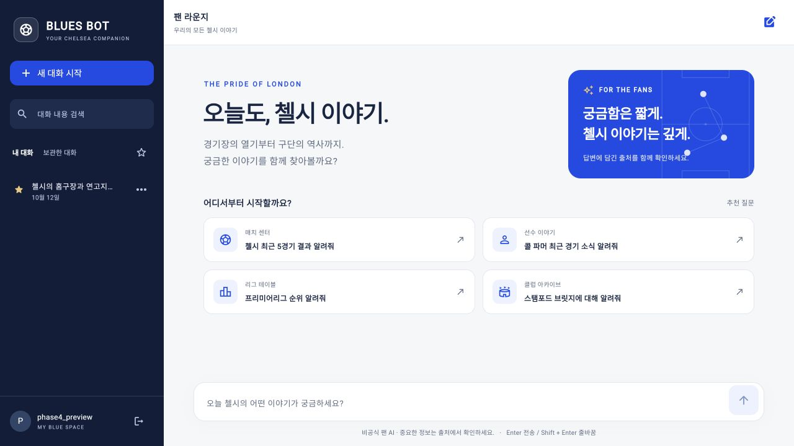

# Chelsea FC Blues Bot · Phase 5

첼시 팬을 위한 **비공식** 챗봇입니다. 구단 문서 RAG, 실시간 도구, 로그인·대화 복원 위에 반응형 팬 라운지, 대화 검색·즐겨찾기, Markdown 답변과 출처 링크를 더했습니다.



## 실행

Python 3.10.12 이상과 uv, Flutter 3.47.2 / Dart 3.13.2에서 개발했습니다.

```sh
cd back
cp -n .env.example .env
# 기존 .env는 덮어쓰지 않습니다. 필요한 API 키를 입력하세요.
uv sync --locked
uv run uvicorn main:app --host 127.0.0.1 --port 8000
```

다른 터미널에서:

```sh
cd front/front
flutter pub get
flutter run -d chrome --web-hostname 127.0.0.1 --web-port 5173 --dart-define=API_BASE_URL=http://127.0.0.1:8000
```

웹 앱을 열어 회원가입하고 로그인합니다. 아이디는 영문·숫자·밑줄 3~32자, 비밀번호는 10~128자입니다. 아이디의 대소문자는 구분하지 않습니다.

**브라우저와 API는 같은 호스트 이름을 사용하세요.** 위 예시는 모두 `127.0.0.1`입니다. `localhost`와 `127.0.0.1`을 섞으면 쿠키 정책으로 로그인 복원이 실패할 수 있습니다. 프론트엔드 Origin은 `CORS_ORIGINS`와 정확히 일치해야 합니다.

- 앱: http://127.0.0.1:5173
- API 명세: http://127.0.0.1:8000/docs
- 상태: http://127.0.0.1:8000/health

## Phase 5 사용법

- 데스크톱(가로 1,000px 이상)은 대화 목록을 상시 표시합니다. 모바일은 왼쪽 상단 **내 대화** 메뉴에서 엽니다.
- **대화 내용 검색**은 저장된 제목·질문·답변을 찾습니다. 최대 80자의 연속 문자열 검색이며 영문 대소문자는 구분하지 않습니다. 보관함·즐겨찾기 필터와 함께 사용할 수 있습니다.
- 대화 메뉴의 **즐겨찾기**는 계정에 저장하고 목록 상단에 표시합니다. 별 버튼은 즐겨찾기만 보여줍니다. 새로고침 시에는 즐겨찾기 순서와 관계없이 가장 최근 활성 대화를 엽니다.
- 보관한 대화도 읽을 수 있습니다. **복원하고 이어가기**를 누르면 다시 질문할 수 있습니다.
- 답변의 제목·강조·목록·표를 표시하고, 넓은 표는 가로로 스크롤합니다. 출처를 펼치면 자료 종류·조회 시각·발췌문·원문 링크를 확인할 수 있습니다.
- **답변 복사**는 원래 Markdown을, 상단 **대화 복사**는 질문·답변·경고·출처를 함께 클립보드에 복사합니다.
- 키보드 Enter는 전송, Shift + Enter는 줄바꿈입니다. 한글 조합 중 Enter는 전송하지 않습니다. 모바일에서는 전송 버튼을 사용하세요.
- 이전 답변을 읽는 동안에는 스트리밍이 화면을 아래로 이동시키지 않습니다. **최신 답변** 버튼으로 돌아올 수 있습니다.

## 계정과 저장

- 웹 로그인은 7일 만료 HttpOnly 쿠키로 유지됩니다. 브라우저 새로고침 후 가장 최근의 활성 대화를 불러옵니다.
- 대화 목록에서 이름 변경, 즐겨찾기, 보관, 보관함에서 복원을 사용할 수 있습니다.
- 새 대화 화면을 여는 것만으로 빈 대화를 만들지 않으며, 첫 질문을 보낼 때 서버가 대화 ID를 생성합니다.
- 완료한 답변의 출처·조회 시각·경고도 함께 저장하고 복원합니다.
- 계정당 최대 100개 대화, 대화당 최근 100턴을 저장합니다. 모델에는 최근 10턴만 전달합니다. 보관은 삭제가 아니며 계정의 보관 한도에 포함됩니다.
- 소유권은 모든 대화 조회·변경과 REST/SSE 채팅 요청에서 검사합니다. 다른 사람의 대화와 존재하지 않는 대화는 모두 404로 응답합니다.
- SQLite를 공유하는 로컬 워커 간 동시 생성 잠금과 요청 제한을 적용합니다. 외부 DB 없이 여러 머신을 묶는 분산 배포는 지원하지 않습니다.

## 설정

| 환경 변수 | 기본값 / 용도 |
| --- | --- |
| `OPENAI_API_KEY` | 도구 선택·답변 생성·임베딩. 미설정 시 채팅 503 |
| `OPENAI_MODEL` | `gpt-4o-mini` |
| `OPENAI_EMBEDDING_MODEL` | `text-embedding-3-small` |
| `TAVILY_API_KEY` | 최신 뉴스 / 일반 웹 검색 |
| `API_FOOTBALL_KEY` | 경기·일정·순위·선수 통계 |
| `CORS_ORIGINS` | `http://localhost:5173,http://127.0.0.1:5173` |
| `AUTH_COOKIE_SECURE` | 로컬 HTTP에서는 `false`. HTTPS 환경에서는 `true` |
| `ALLOW_REGISTRATION` | 기본 `true`. `false`이면 신규 가입 중지, 기존 로그인 가능 |

쿠키를 사용하므로 CORS Origin의 `*`는 허용하지 않습니다. 웹 프론트엔드는 인증 요청에 쿠키를 포함합니다. 변경 요청의 Origin도 검사합니다. API 키는 백엔드 `.env`에만 저장하세요.

API-Football은 API-SPORTS 직접 가입 키와 `x-apisports-key` 헤더를 사용합니다. RapidAPI 키와는 다릅니다. 최신 시즌·최근 경기·선수 기록의 제공 범위는 요금제에 따라 달라집니다. `/health`는 연동 키 설정 여부만 보여주며 공급자의 인증·가용성을 확인하지 않습니다.

## 인증 및 대화 API

**Phase 3의 익명 채팅 요청은 Phase 4부터 401로 차단됩니다.** 먼저 로그인하고 `POST /api/v1/conversations`에서 받은 ID를 채팅의 `session_id`에 사용해야 합니다.

| 메서드 / 경로 | 용도 |
| --- | --- |
| `POST /api/v1/auth/register` | `username`, `password`로 가입 및 로그인 |
| `POST /api/v1/auth/login` | 로그인 |
| `GET /api/v1/auth/me` | 현재 사용자 |
| `POST /api/v1/auth/logout` | 현재 로그인 토큰 폐기 |
| `POST /api/v1/conversations` | 내 대화 생성 |
| `GET /api/v1/conversations?archived=false` | 내 활성 대화 목록 |
| `GET /api/v1/conversations?archived=true` | 내 보관함 |
| `GET /api/v1/conversations?q=파머&pinned_only=true` | 제목·질문·답변 검색 + 즐겨찾기 필터 |
| `GET /api/v1/conversations/{id}` | 완료한 대화와 출처 복원 |
| `PATCH /api/v1/conversations/{id}` | `{"title":"경기 이야기"}`로 이름 변경 |
| `POST /api/v1/conversations/{id}/archive` | `{"archived":true}` 보관 / `false` 복원 |
| `POST /api/v1/conversations/{id}/pin` | `{"pinned":true}` 즐겨찾기 / `false` 해제 |
| `POST /api/v1/chat` | 일반 답변 |
| `POST /api/v1/chat/stream` | SSE 답변 |

브라우저는 HttpOnly 쿠키를 사용하며 토큰을 localStorage에 저장하지 않습니다. 네이티브 클라이언트는 가입·로그인 시 `X-Client-Platform: native`를 보내면 응답의 `token`을 받을 수 있고, 이후 `Authorization: Bearer <token>`으로 인증합니다. 현재 Flutter 네이티브 클라이언트는 이 토큰을 메모리에만 보관하므로 앱 재실행 후 로그인해야 대화를 복원할 수 있습니다.

비밀번호는 무작위 salt와 PBKDF2-HMAC-SHA256 600,000회로 해시합니다. 로그인 토큰은 32바이트 난수이며 DB에는 토큰의 SHA-256 해시만 저장합니다. 토큰은 7일 후 만료하고, 계정당 최근 10개 로그인을 유지합니다.

이메일 인증·비밀번호 재설정·소셜 로그인·계정 삭제는 아직 포함하지 않습니다. 공개 운영 시 HTTPS, 안전한 DB 백업과 운영 정책이 필요합니다.

## 답변 및 오류

SSE 이벤트는 `status` → `sources` → `token`(여러 번) → `done`입니다. 답변 생성 상태에 따라 `status`가 반복됩니다. 오류는 `error`로 종료하며 미완료 답변은 저장하지 않습니다. 10초 heartbeat, 120초 전체 요청 제한을 유지합니다.

출처에는 제목·종류·본문 일부·URL·조회 시각·발행일·캐시 여부가 있습니다. API-Football URL은 인증이 필요한 API 주소이며 키를 포함하지 않습니다.

| 상태 | 의미 |
| --- | --- |
| 401 | 로그인 없음·만료·폐기 |
| 403 | 허용되지 않은 Origin / 회원가입 중지 |
| 404 | 존재하지 않거나 내 소유가 아닌 대화 / 보관한 대화의 채팅 |
| 409 | 답변 생성 중인 대화 / 이름·가입·보관 한도 충돌 |
| 422 | 잘못된 입력 |
| 429 | 사용자별 요청 또는 전체 동시 요청 한도 |
| 503 | OpenAI 키 미설정 |
| 502 / 504 | 일반 답변 생성 실패 / 시간 초과 |

가입·로그인은 IP별 분당 10회, 채팅은 사용자별 분당 20회입니다. 동시에 생성 가능한 답변은 공유 DB 기준 32개입니다. 고정된 1분 구간으로 제한하며 실제 결제 금액의 상한을 보장하는 과금 예산은 아닙니다. 역방향 프록시를 사용하면 신뢰할 프록시 주소와 실제 클라이언트 IP 전달을 운영 환경에 맞게 설정해야 합니다.

## 저장과 업그레이드

- `back/runtime/history.sqlite3`: 계정, 해시된 인증 정보, 대화, 출처, 요청 제한, 생성 잠금. 계정 정보가 포함되므로 외부에 업로드하지 마세요.
- 기존 Phase 3 DB는 시작 시 필요한 컬럼과 테이블을 추가합니다. 이전 기록은 보존하지만 소유자가 없으므로 새 계정에 공개하지 않습니다. 업그레이드 전 서버를 멈추고 DB를 백업하는 것을 권장합니다.
- Phase 4 DB에는 `pinned` 컬럼을 기본 `false`로 추가합니다. 계정·기존 대화·출처를 유지하며, 별 표시를 변경해도 대화의 마지막 답변 시각은 바꾸지 않습니다.
- `back/data/*.txt`는 최초 문서 검색 시 인덱싱합니다. 문서 변경은 서버 재시작 후 반영합니다.
- `back/chroma_phase3/`를 계속 사용하고 Phase 2 DB는 보존합니다.
- 생성 잠금은 토큰으로 구분하고, 작업 종료·취소 시 해제합니다. 워커 비정상 종료 때는 요청 제한 시간 + 30초 후 만료합니다.
- 사용자 대화를 7일 후 지우던 Phase 3 정책을 제거했습니다. 대화는 최근 100턴 한도 내에서 유지됩니다.

Android 에뮬레이터는 `API_BASE_URL=http://10.0.2.2:8000`을 사용하며 debug 빌드에서 로컬 HTTP를 허용합니다. 실제 기기는 HTTPS 백엔드 주소를 지정하세요. 네이티브 바이너리 빌드는 이번 검증에 포함하지 않습니다.

## 검증

```sh
cd back
uv run python -m unittest discover -s tests -v
cd ../front/front
dart format --output=none --set-exit-if-changed lib test
flutter analyze
flutter test
flutter build web --release --dart-define=API_BASE_URL=http://127.0.0.1:8000
```

GitHub Actions 설정은 백엔드 Python 3.10/3.12 테스트, Flutter 정적 검사·테스트·웹 빌드를 포함하며 외부 API 키 없이 실행합니다. 원격 CI 결과는 GitHub Actions에서 별도로 확인해야 합니다.

개발기: [Phase 3](docs/phase3-blog.md) · [Phase 4](docs/phase4-blog.md) · [Phase 5](docs/phase5-blog.md)
