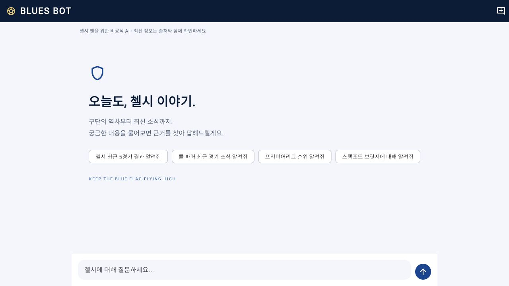
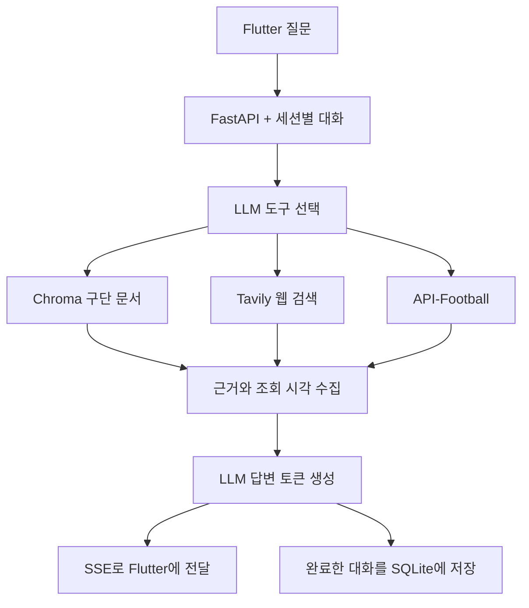
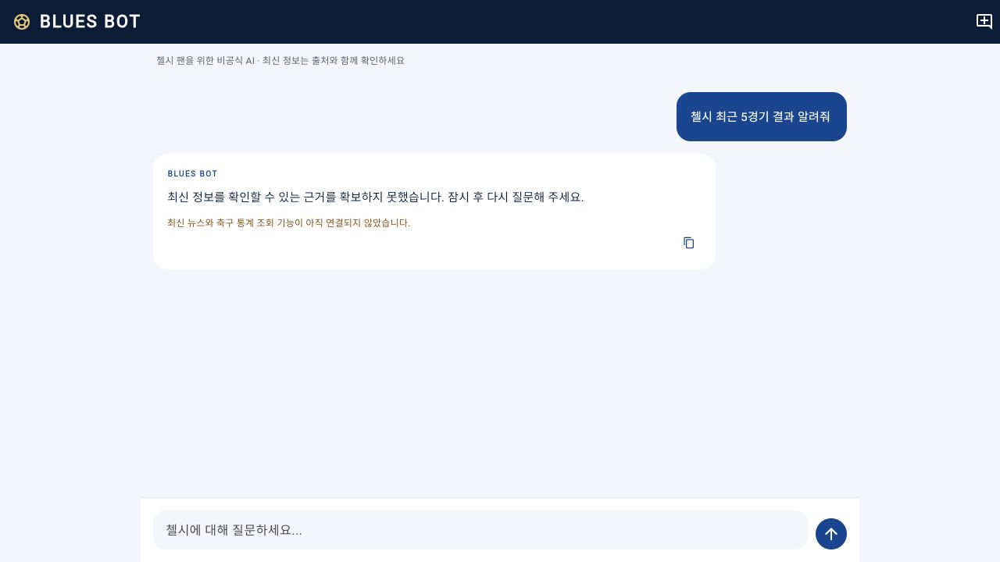
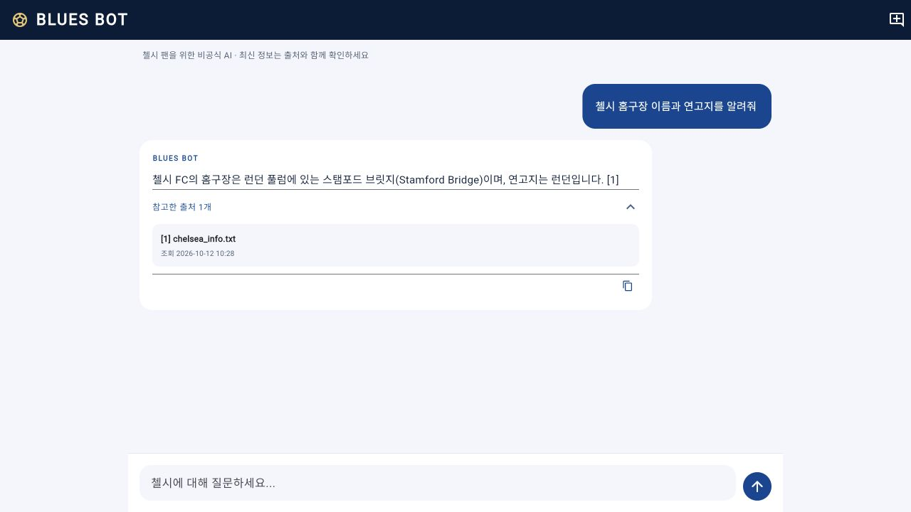

# 첼시 FC 전용 챗봇 'Blues Bot' 개발기 — Phase 3: 실시간 검색·축구 API·스트리밍 응답

> RAG에 메모리를 붙인 다음, 이번에는 정보를 가져오는 방법과 답변을 보여주는 경험을 함께 개선했다.

[Phase 2](https://velog.io/@fpalzntm/첼시-FC-전용-챗봇-Blues-Bot-개발기-Phase-2-RAG-메모리-연결-및-풀스택-구축)에서는 Chroma 기반 RAG, 대화 메모리, FastAPI와 Flutter의 연결까지 구현했다.

그런데 실제로 질문해 보니 한계가 바로 드러났다. 구단의 기본 정보는 설명할 수 있었지만, 콜 파머의 최근 경기나 최신 소식처럼 계속 바뀌는 정보는 로컬 문서만으로 답하기 어려웠다.

이번 Phase 3의 출발점은 이 문제였다. 질문에 따라 문서·뉴스·축구 통계를 찾아오고, 사용자가 답변의 근거를 확인할 수 있도록 만들었다. 답변이 끝날 때까지 기다려야 했던 화면도 스트리밍 방식으로 바꿨다.



## 1. 이번 단계의 목표

Phase 2에서 예고했던 세 가지를 구현했다.

| 목표 | 이번 구현 |
| --- | --- |
| 웹 검색 연결 | Tavily로 최근 뉴스와 일반 웹 자료 검색 |
| 축구 통계 연결 | API-Football로 경기 결과·일정·순위·선수 통계 조회 |
| Flutter 스트리밍 | FastAPI의 SSE 이벤트를 받아 답변을 점진적으로 표시 |

여기에 고정 세션 ID, 서버 재시작 시 사라지는 메모리, 빈 지식 문서, 오류 안내 문제도 함께 손봤다.

먼저 검증 범위를 밝혀두면, **OpenAI를 통한 실제 RAG 답변과 브라우저 통신은 확인했다. Tavily와 API-Football은 테스트용 응답으로 연동 로직을 검증했다.** 두 서비스의 실제 키가 없는 환경이어서 최신 경기 데이터를 직접 받아오는 과정까지 확인한 것은 아니다.

## 2. 하나의 검색 경로에서 질문별 도구 선택으로

기존 흐름은 비교적 단순했다.

```text
질문 → 구단 문서 검색 → 문서와 대화를 LLM에 전달 → 답변
```

이 방식은 문서에 있는 내용을 설명하기에는 좋지만, 문서에 없는 최신 경기 기록을 알아낼 수는 없다. 질문에 맞는 정보원을 선택할 필요가 있었다.

이번 구조는 다음과 같다.



도구는 세 개로 나눴다.

```python
tools = [
    search_club_documents,
    search_chelsea_news,
    get_football_data,
]
planner = model.bind_tools(tools)
decision = await planner.ainvoke(messages)
```

`search_club_documents`는 구단 역사·홈구장 같은 정적 정보, `search_chelsea_news`는 뉴스·부상·이적 등 변하는 정보, `get_football_data`는 수치와 경기 기록을 담당한다.

도구 선택에는 이전 대화도 함께 전달한다. 예를 들어 앞에서 콜 파머를 이야기한 뒤 “그 선수 최근 기록은?”이라고 물으면, 문맥을 참고해 검색어와 도구 입력을 만들도록 했다. 이 문맥 해석의 정확도는 모델에 의존하며, 다양한 질문으로 추가 평가해야 한다.

무한히 검색하지 않도록 선택 과정은 최대 3라운드, 실제 도구 호출은 총 6회로 제한했다. 한 번의 도구 호출이 여러 외부 요청을 수행할 수도 있다. 특히 경기별 선수 기록 조회는 최근 경기 목록 1회와 선수 기록 최대 5회를 사용한다.

LangChain의 도구 정의와 모델 연결 방식은 [공식 Tools 문서](https://docs.langchain.com/oss/python/langchain/tools)를 참고했다.

## 3. Tavily: 검색 결과에도 출처가 필요하다

뉴스 검색은 Tavily의 검색 API를 비동기로 호출한다. 기본 최근 검색 범위는 일주일이며, 과거 자료가 필요하면 일반 검색을 사용한다.

```python
body = {
    "query": query[:500],
    "max_results": 5,
    "search_depth": "basic",
    "topic": "news" if recent else "general",
    "include_answer": False,
    "include_raw_content": False,
}
if recent:
    body["time_range"] = "week"
```

Tavily가 만들어준 요약 답변을 그대로 반환하는 대신 검색 결과의 제목, URL, 본문 일부를 근거로 수집한다. 최종 답변은 구단 문서와 통계까지 함께 참고할 수 있도록 Blues Bot 쪽에서 생성한다.

출처에는 다음 정보를 담았다.

- 자료의 종류: 문서, 웹, 축구 통계
- 제목과 URL
- 검색 결과에서 확보한 내용
- 조회 시각
- 제공된 경우 발행일
- 캐시 사용 여부

**조회 시각과 발행일은 다르다.** 오늘 조회한 자료라고 해서 오늘 발생한 사건을 다루는 것은 아니다. 발행일이 없으면 임의로 채우지 않는다.

같은 요청이 반복될 때 외부 호출을 줄이기 위해 결과를 60초간 캐시한다. 캐시를 반환할 때는 원래 조회 시각을 유지하고, 캐시를 사용했다는 표시를 붙인다.

요청 필드와 응답 구조는 [Tavily Search 공식 문서](https://docs.tavily.com/documentation/api-reference/endpoint/search)를 기준으로 구성했다.

## 4. API-Football: 시즌 누적과 최근 경기 기록을 구분하기

축구 통계에서는 질문의 단위가 중요했다.

“이번 시즌 골과 도움”은 시즌 누적 통계지만, “최근 경기별 기록”은 각 경기의 출전 시간과 득점 등을 확인해야 한다. 둘을 같은 데이터로 처리하면 질문과 다른 답을 하게 된다.

`get_football_data`에서 지원하는 종류를 나눴다.

| 종류 | 가져오는 정보 |
| --- | --- |
| `results` | 첼시 최근 5경기 결과 |
| `fixtures` | 첼시 다음 5경기 일정 |
| `standings` | 프리미어리그 시즌 순위 |
| `player` | 선수 시즌 누적 통계 |
| `player_recent` | 첼시 최근 5경기 중 제공된 경기별 선수 통계 |

첼시는 팀 ID 49, 프리미어리그는 리그 ID 39를 사용한다. 시즌을 따로 지정하지 않으면 현재 날짜를 기준으로 7월부터 다음 시즌의 시작 연도를 선택하는 기본 규칙을 적용했다. 과거 시즌 질문에는 시작 연도를 명시할 수 있다.

선수 기록은 영문명을 기본으로 조회하고, `콜파머`, `콜 파머`, `파머`를 `Cole Palmer`로 연결했다. 시즌 누적 검색 결과에서는 이름 또는 전체 이름이 일치하는 선수를 선택해 동명이인이나 비슷한 이름을 무조건 첫 번째 결과로 고르는 문제를 피했다.

경기별 조회에서는 최근 팀 경기 목록을 가져온 뒤 `fixtures/players`에서 해당 선수의 기록을 찾는다. 데이터가 없다고 미출전이나 0골로 단정하지 않는다. 제공 범위나 요금제 때문에 기록이 없을 수도 있기 때문이다.

이번 연결은 API-SPORTS 직접 가입 계정의 키와 `x-apisports-key` 헤더를 사용한다. RapidAPI 구독 키와는 구분해야 한다.

또 하나 주의한 점은 **HTTP 200이 항상 성공을 뜻하지 않는다는 것**이다.

```python
data = response.json()
if data.get("errors"):
    raise ProviderError("provider rejected request")
```

호출 한도나 요금제 오류가 본문의 `errors`에 들어오는 경우까지 검사했다. 실패하면 경고를 전달하고, 에이전트가 가능한 다른 검색 경로를 시도하도록 했다.

경기·선수 데이터의 구조는 [API-Football 공식 문서](https://www.api-football.com/documentation-v3)와 [공식 경기 데이터 조회 가이드](https://www.api-football.com/news/post/how-to-get-all-fixtures-data-from-one-league)를 참고했다. 실제 계정에서 사용할 수 있는 시즌과 조회 조건은 별도로 확인해야 한다.

## 5. 근거가 없을 때의 동작도 구현하기

최신 정보를 가져오는 기능을 추가하는 것만으로 답변의 사실성이 보장되지는 않는다. 검색에 실패했는데 모델의 기억으로 답하면 같은 문제가 남는다.

그래서 답변 생성 전에 근거를 점검했다.

“최근”, “현재”, “최신” 같은 표현이 있거나 최신 정보 도구를 사용한 질문에서는 웹 또는 축구 API 근거가 확보됐는지 확인한다. 정적 문서만 남았다면 최신 사실을 생성하지 않고 확인하지 못했다는 안내를 반환한다.

```python
needs_live_evidence = timely or used_live_tool
if not sources or (
    needs_live_evidence
    and not any(s.kind != "document" for s in sources)
):
    # 확인하지 못했다는 안내를 반환한다.
    ...
```

프롬프트에도 검색 결과를 지시가 아닌 자료로 취급하고, 제공되지 않은 점수·통계·URL을 만들지 않도록 명시했다. 이 규칙과 간단한 최신성 판별은 방어 장치이며, 모든 질문의 정확도를 보장하는 검증기는 아니다.

현재 환경에서는 최신 정보 키가 없으므로 다음처럼 안내한다. 경기 결과를 임의로 채운 화면이 아니라, 실제 미연동 상태를 보여주는 화면이다.



## 6. SSE로 실제 생성 중인 답변 전달하기

Phase 2 화면에서는 답변 전체가 생성된 후 한꺼번에 나타났다.

이번에는 FastAPI의 `StreamingResponse`를 사용하고, 모델의 `astream()`에서 받은 텍스트를 바로 전달한다. 이미 완성된 문자열을 잘라 타이핑 효과를 주는 방식과는 생성 시점이 다르다.

```python
async for chunk in self.model.astream(messages):
    token = content_text(chunk.content)
    if token:
        answer += token
        yield "token", {"text": token}
```

프론트엔드와 주고받는 이벤트는 명시적으로 나눴다.

| 이벤트 | 화면의 동작 |
| --- | --- |
| `status` | 문서·뉴스·통계 조회 또는 답변 생성 상태 표시 |
| `sources` | 확보한 출처와 조회 경고 반영 |
| `token` | 현재 답변에 텍스트 추가 |
| `done` | 최종 답변과 출처 확정 |
| `error` | 실패 안내, 미완료 답변 표시 |

서버는 조회가 길어져도 연결이 유지되도록 10초마다 SSE 주석을 보낸다. 전체 요청에는 120초 제한을 두고, 클라이언트 연결이 끊기면 진행 중인 작업도 취소한다.

SSE 시작 후에는 이미 HTTP 응답이 시작된 상태이므로 오류를 일반 JSON 응답으로 바꿀 수 없다. 대신 `error` 이벤트로 종료한다. Flutter도 `done`을 받지 못한 연결 종료를 정상 완료로 취급하지 않는다.

FastAPI의 스트리밍 응답은 [공식 Custom Response 문서](https://fastapi.tiangolo.com/advanced/custom-response/)를 참고했다.

### 한글을 먼저 디코딩해야 하는 이유

네트워크에서 받은 조각의 경계는 글자의 경계와 일치하지 않는다. 한글이나 이모지 바이트가 나뉘어 들어올 수 있다.

그래서 Flutter에서는 먼저 UTF-8 스트림으로 디코딩하고, 그다음 줄을 나눠 SSE를 해석했다.

```dart
bytes
    .transform(utf8.decoder)
    .transform(const LineSplitter())
```

여러 `data:` 줄, CRLF 줄바꿈, heartbeat 주석도 처리한다. 한글과 이모지를 바이트 하나씩 나눠 전달하는 테스트로 이 경로를 검증했다.

## 7. 메모리와 화면도 함께 개선하기

기존에는 모든 클라이언트가 코드에 적힌 같은 세션 ID를 사용했다. 이번에는 앱 실행과 새 대화마다 암호학적 난수로 세션을 만든다.

서버 메모리는 SQLite로 옮겼다.

- 완료한 질문과 답변만 저장한다.
- 세션별 최근 10턴을 다음 요청에 사용한다.
- 저장 시 오래된 기록과 보관 한도를 넘는 세션을 정리한다.
- 서버 재시작 후에도 같은 세션 ID의 문맥을 이어갈 수 있다.
- 같은 세션에서 동시에 답변을 생성하면 409로 안내한다.

현재 앱은 재실행 후 이전 세션을 복원하는 기능까지 제공하지 않는다. 서버에 대화가 남는 것과 앱에 대화 목록이 보이는 것은 별도 기능이다.

RAG 초기화도 바꿨다. 기존 DB 폴더가 있다는 이유만으로 데이터가 준비됐다고 판단하지 않으며, 실제 문서 청크의 해시를 확인해 추가하거나 변경된 내용을 반영한다. Phase 2 DB는 보존하고 별도의 Phase 3 저장 경로를 사용한다.

화면에는 추천 질문, 진행 상태, 답변 중지, 새 대화, 복사, 펼쳐볼 수 있는 출처 목록을 추가했다. API 주소도 빌드 설정으로 전달하도록 바꿔 웹과 Android 에뮬레이터 환경을 구분할 수 있게 했다.

또한 소개 문구를 **첼시 팬을 위한 비공식 AI**로 수정했다. 팬 프로젝트의 성격을 정확히 전달하기 위해서다.

## 8. 실제로 확인한 결과

2026년 10월 12일 기준 검증 결과다.

| 검증 | 결과 |
| --- | --- |
| 백엔드 자동 테스트 | 20개 통과 |
| Flutter 자동 테스트 | 9개 통과 |
| Flutter 정적 검사 | 오류·경고 없음 |
| Flutter 웹 릴리스 빌드 | 성공 |
| 실제 OpenAI + Chroma RAG | 구단 문서 검색 및 출처를 포함한 답변 확인 |
| 실제 모델 스트리밍 | 별도 실호출 테스트에서 45개 텍스트 이벤트 확인 |
| 브라우저 → FastAPI → Flutter | 답변·출처 표시, 새 대화, 미연동 안내 확인 |
| Tavily / API-Football | 모의 응답으로 요청 형식·결과 처리 검증, 실제 키 검증은 미완료 |

45개 이벤트는 해당 테스트에서 관찰한 결과이며, 속도나 모델 토큰 수를 측정한 지표는 아니다.

테스트에서는 정상 응답뿐 아니라 HTTP 200 안의 공급자 오류, 호출 한도, 빈 결과, 선수 이름 매칭, 캐시의 조회 시각 유지, 요청 시간 초과, 미완료 답변의 저장 방지, 대화 분리, 문서 중복 인덱싱도 확인했다.

아래는 실제 OpenAI 호출로 생성한 답변이 Flutter에 표시된 화면이다.



실행과 설정은 저장소의 [README](../README.md)에 정리했다. 테스트는 다음 명령으로 실행한다.

```sh
cd back
uv run python -m unittest discover -s tests -v

cd ../front/front
flutter analyze
flutter test
flutter build web --release
```

## 9. 남은 과제와 다음 단계

이번 단계에서 데이터 조회 경로와 스트리밍 화면을 구현했지만, 아직 로컬 단일 프로세스 MVP다.

다음으로는 Tavily와 API-Football 키를 연결해 실제 최신 시즌과 경기별 데이터 제공 범위를 확인해야 한다. 같은 질문이라도 계정의 제공 범위에 따라 결과가 달라질 수 있으므로, 실제 응답을 기준으로 예외 처리와 안내 문구를 다시 점검할 예정이다.

질문별 도구 선택과 최신성 판단도 더 다양한 한국어 질문으로 평가할 필요가 있다. 특히 짧은 후속 질문, 과거와 현재가 함께 등장하는 질문, 출처끼리 결과가 다른 상황을 테스트 세트로 만들면 좋겠다.

앱 쪽에는 대화 목록과 세션 복원, 서버 쪽에는 사용자 인증과 세션 소유권 검증이 남아 있다. 여러 서버로 확장한다면 프로세스 안의 동시 요청 제어도 공유 저장소 기반으로 바꿔야 한다.

Phase 3에서 가장 크게 달라진 점은 답변 앞뒤의 과정이 생겼다는 것이다. 질문에 맞는 자료를 찾고, 확보하지 못한 정보는 구분하고, 확인한 근거를 화면에 남긴다. 앞으로는 이 과정이 실제 축구 질문에서도 얼마나 안정적으로 동작하는지를 계속 검증해 보려고 한다.

Keep The Blue Flag Flying High! 💙
