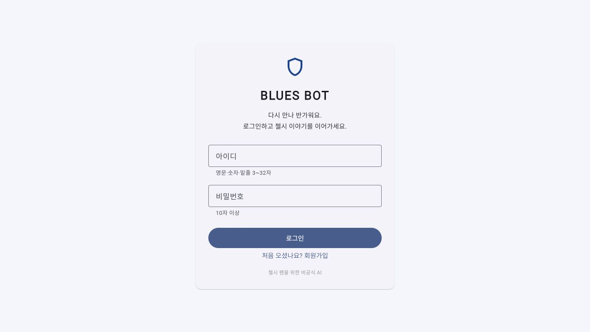
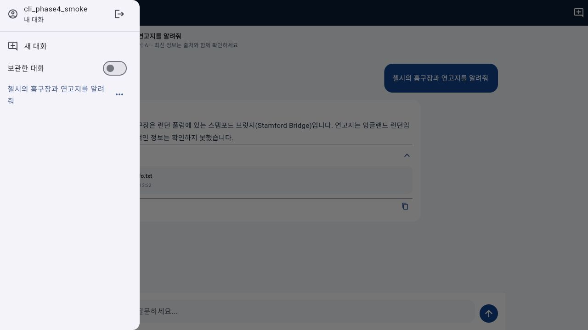
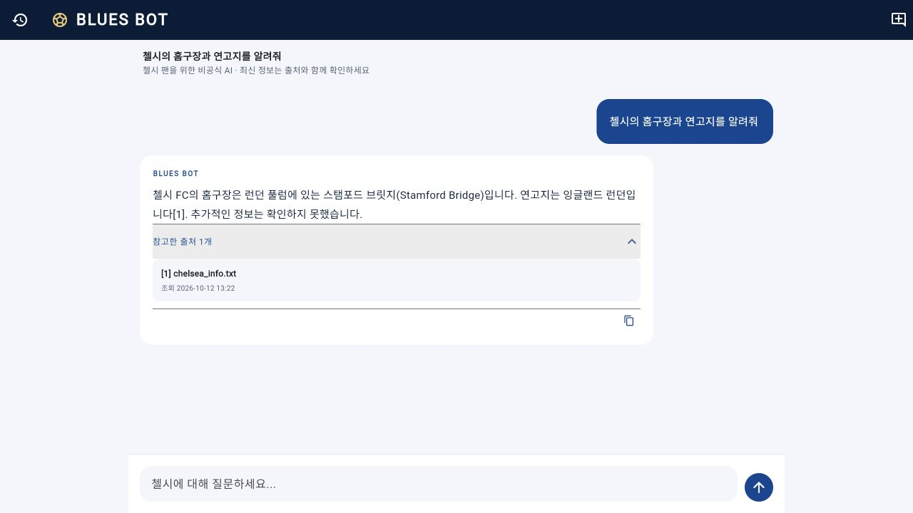

# 첼시 FC 전용 챗봇 'Blues Bot' 개발기 — Phase 4: 로그인과 내 대화 복원

> 답변을 생성하는 챗봇에서, 사용자가 돌아와 자기 대화를 이어갈 수 있는 앱으로.

[Phase 3](phase3-blog.md)에서는 구단 문서 RAG에 웹 검색과 축구 통계 도구를 연결하고, Flutter에서 실제 답변 토큰을 스트리밍하도록 만들었다.

이제 답변을 주고받을 수는 있지만, 앱을 다시 열면 이전 대화가 화면에 돌아오지 않았다. 서버에 기록이 남아 있는 것과 사용자가 대화를 이어갈 수 있는 경험은 달랐다.

접근 권한도 과제로 남아 있었다. Phase 3에서는 클라이언트가 대화 ID를 정했고, 그 ID를 아는 사람이 같은 문맥을 사용할 수 있었다. 사용자별 대화를 제공하려면 로그인과 소유권 검사가 필요했다.

이번 Phase 4에서는 **계정, 대화 목록·복원, 대화별 권한, 요청 제한**을 구현했다. 정적 문서와 실시간 검색의 구조는 유지하면서 대화의 저장과 접근 방식을 바꿨다.



## 1. 이번 단계에서 달라진 사용 흐름

앱을 열면 로그인 화면이 나타난다. 처음 사용하는 사람은 아이디와 비밀번호로 가입할 수 있다.

로그인 뒤에는 가장 최근의 활성 대화를 불러온다. 내 대화 메뉴에서 다른 대화를 선택하거나 이름을 바꾸고, 사용하지 않는 대화는 보관함으로 옮길 수 있다. 보관한 대화는 다시 복원할 수 있다.

| 동작 | Phase 3 | Phase 4 |
| --- | --- | --- |
| 사용자 구분 | 대화 ID | 로그인한 계정 |
| 대화 생성 | 앱에서 ID 생성 | 서버에서 소유자와 함께 생성 |
| 앱 재실행 | 새 화면에서 시작 | 웹 로그인과 최근 대화 복원 |
| 지난 답변 | 서버 메모리 용도로 저장 | 질문·답변·출처·경고를 화면으로 복원 |
| 접근 권한 | 대화 ID에 의존 | 모든 대화 API에서 소유권 확인 |
| 동시 요청 제어 | 프로세스 안의 상태 | 공유 SQLite의 작업 잠금 |

새 대화 화면을 여는 것만으로 DB에 빈 대화를 추가하지는 않는다. 첫 질문을 보낼 때 서버에 대화를 생성한다.



## 2. 로그인은 비밀번호와 인증 세션을 분리해서 저장하기

이번에는 외부 로그인 서비스를 추가하지 않고 아이디 기반 계정을 구현했다. 이메일 주소와 같은 추가 개인정보 없이 가입하도록 했다.

비밀번호는 평문으로 저장하지 않는다. 계정마다 무작위 salt를 만들고, Python 표준 라이브러리의 PBKDF2-HMAC-SHA256을 600,000회 적용한다.

```python
salt = secrets.token_bytes(16)
digest = hashlib.pbkdf2_hmac(
    "sha256",
    password.encode(),
    salt,
    600_000,
)
```

같은 비밀번호를 사용해도 salt가 다르면 저장된 해시가 달라진다. 비밀번호의 앞뒤 공백도 임의로 제거하지 않는다. 비교에는 `hmac.compare_digest`를 사용한다.

로그인 성공 시에는 비밀번호와 별개로 32바이트 난수 토큰을 발급한다. DB에는 토큰 원문 대신 SHA-256 해시와 사용자 ID, 만료 시각을 저장한다.

인증 토큰은 이미 충분한 무작위성을 가진 값이므로, 사용자 비밀번호에 적용한 느린 해시와 용도가 다르다. 요청에서 받은 토큰을 해시해 저장된 세션과 비교하고, 로그아웃하면 해당 세션을 폐기한다. 만료 기간은 7일이다.

비밀번호 저장 방식은 [OWASP Password Storage 가이드](https://cheatsheetseries.owasp.org/cheatsheets/Password_Storage_Cheat_Sheet.html)를, 인증 세션 관리는 [OWASP Session Management 가이드](https://cheatsheetseries.owasp.org/cheatsheets/Session_Management_Cheat_Sheet.html)를 참고했다. 이 구현만으로 공개 서비스의 모든 보안 요구를 충족했다고 주장하는 것은 아니다.

### 웹과 네이티브의 로그인 유지 방식

웹에서는 HttpOnly 쿠키를 사용한다. Flutter가 토큰을 localStorage에 저장하지 않으며, 브라우저가 API 요청에 쿠키를 전달한다. 새로고침 후에는 `/api/v1/auth/me`에서 로그인 상태를 확인한다.

쿠키는 `SameSite=Lax`를 적용하고, HTTPS 운영 환경에서는 `AUTH_COOKIE_SECURE=true`로 설정한다. 로컬 HTTP 개발에서만 기본값인 `false`를 사용한다.

네이티브 앱은 쿠키 대신 Bearer 토큰을 사용할 수 있도록 했다. 현재 Flutter 네이티브 클라이언트는 토큰을 메모리에만 보관한다. 따라서 앱을 다시 실행하면 로그인해야 하지만, 같은 계정으로 로그인한 뒤 서버의 대화 목록을 복원할 수 있다. 네이티브의 자동 로그인 저장소는 이후 과제로 남겼다.

## 3. 대화 ID를 아는 것과 접근 권한은 다르다

Phase 4의 대화에는 `owner`가 있다.

```text
users
  └─ auth_sessions: 로그인한 계정 확인
  └─ conversations: 사용자 소유의 대화
       └─ turns: 질문, 답변, 출처, 경고
```

클라이언트는 더 이상 임의의 대화 ID만 보내서 답변을 생성할 수 없다. 로그인 후 서버에서 대화를 만들고, 반환된 ID를 채팅의 `session_id`로 사용해야 한다.

```text
로그인
  → POST /api/v1/conversations
  → 서버가 대화 ID와 소유자 저장
  → POST /api/v1/chat/stream
  → 인증 + 소유권 확인
  → 답변 생성
```

소유권 검사는 목록·상세 조회·이름 변경·보관과 복원·일반 채팅·스트리밍 채팅에 적용했다. 다른 사람의 대화 ID와 존재하지 않는 ID는 모두 404로 응답한다.

보관한 대화는 목록과 기록을 유지하지만 바로 새 질문을 보낼 수는 없다. 먼저 복원한 후 대화를 이어간다.

CORS만으로 이런 권한을 대신할 수는 없다. 브라우저의 요청 Origin을 제한하는 것과, 로그인한 사람이 해당 대화의 소유자인지 검사하는 것은 별도 처리다.

이번에는 허용할 Origin을 명시하고 변경 요청에서도 Origin을 확인했다. 쿠키를 사용하는 설정에서 `*` Origin은 거부한다. 개발할 때도 프론트엔드와 API의 호스트 이름을 맞춰야 한다. `localhost`와 `127.0.0.1`을 섞으면 쿠키 정책 때문에 로그인 복원이 실패할 수 있다.

## 4. 답변의 근거까지 복원하기

지난 답변을 다시 열었을 때 본문만 보인다면, 그 답변이 어떤 자료를 참고했는지 확인하기 어렵다.

그래서 완료한 대화에 다음 내용을 함께 저장했다.

- 사용자의 질문과 최종 답변
- 참고한 출처와 조회 시각
- 발행일과 캐시 사용 여부
- 조회 과정에서 발생한 경고

복원할 때는 이 데이터를 다시 사용자 메시지와 봇 메시지로 구성한다. 출처의 조회 시각도 새로 만들어 넣지 않고 원래 값을 유지한다.

저장 한도와 모델 문맥의 길이는 분리했다. 대화당 최근 100턴을 화면에서 복원할 수 있지만, 다음 답변을 만드는 모델에는 최근 10턴만 전달한다. 계정당 대화는 최대 100개이며 보관한 대화도 포함한다.

기존 Phase 3에서는 오래된 기록을 저장 시 정리했지만, Phase 4에서는 사용자 대화를 일괄적으로 7일 후 삭제하지 않는다. 대신 대화별 보관 한도를 적용한다. 보관함으로 옮기는 동작도 삭제가 아니다.

아래는 실제 OpenAI 답변을 받은 뒤 **브라우저를 새로고침하여 복원한 화면**이다. 다시 모델을 호출해 같은 답변을 만드는 것이 아니라, 저장된 질문·답변·근거를 불러온 결과다.



### 기존 기록은 보존하되 임의로 공개하지 않기

기존 SQLite DB에는 소유자 정보가 없는 Phase 3 대화가 있었다.

업그레이드에서는 필요한 테이블과 컬럼을 추가하고 기존 기록을 보존했다. 다만 처음 가입한 사용자에게 과거 대화를 전부 연결하지는 않는다. 해당 기록의 주인이 누구인지 판단할 근거가 없기 때문이다.

새 계정의 대화 목록과 API에는 그 계정에 속한 대화만 나타난다. 이전 기록을 특정 계정으로 옮기는 기능은 이번에 구현하지 않았다.

## 5. 여러 요청이 들어올 때의 동작

로그인을 붙이면 사용자별 요청 제한도 적용할 수 있다.

가입·로그인은 IP별 분당 10회, 채팅은 사용자별 분당 20회로 제한했다. 제한 상태는 SQLite에 저장하므로 같은 DB를 공유하는 워커가 각각 별도의 예산을 갖지 않는다.

한 사용자에게 여러 대화가 있어도 채팅 한도는 합산한다. 사용자별 호출 횟수를 제한하는 기능이며, 실제 API 청구 금액의 상한을 보장하는 과금 예산은 아니다.

동시 답변 생성은 공유 DB 기준 최대 32개다. 같은 대화에서 두 요청이 동시에 실행되는 것도 막는다.

```python
db.execute("BEGIN IMMEDIATE")
# 대화 소유자와 보관 상태 확인
# 만료된 작업 잠금 정리
# 이미 생성 중인지, 요청 한도를 넘었는지 확인
# 새 작업 토큰과 만료 시각 저장
```

답변 생성 잠금에는 작업별 토큰을 붙였다. 예전 작업의 정리 코드가 나중에 실행되더라도 새 작업의 잠금을 지우지 않도록, 해제 시 대화 ID와 작업 토큰을 함께 비교한다.

워커가 비정상 종료해 정리 코드를 실행하지 못하면 잠금은 전체 요청 제한 시간에 30초를 더한 시점에 만료된다. 정상 완료·오류·취소에서는 바로 해제한다.

현재 방식은 **하나의 SQLite 파일을 공유하는 로컬 워커**를 위한 것이다. 여러 머신의 분산 배포까지 해결한 구조는 아니며, 그런 환경에서는 공유 DB와 작업 제어 방식을 다시 선택해야 한다.

## 6. 스트리밍 취소와 화면 복원도 실제로 테스트하기

Phase 3의 SSE 이벤트 구조는 유지했다. 완료한 답변만 저장하고, 연결이 중간에 끊기면 미완료 답변으로 처리한다.

이번에는 실제 로컬 소켓 연결로 답변의 첫 텍스트를 받은 뒤 클라이언트 연결을 닫는 검증도 수행했다. 진행 중인 생성 작업이 취소되고, 작업 잠금이 해제되며, 부분 답변이 대화 기록에 남지 않는 것을 확인했다. 이 취소 검증은 느리게 응답하는 테스트 모델로 수행했다.

대화 복원 테스트를 추가하면서 기존 출처 목록의 화면 문제도 발견했다. 출처 펼치기 위젯이 색이 있는 컨테이너 안에 배치되어 Flutter의 Material 관련 검증에 걸렸다. 출처 목록에 Material을 적용한 뒤, 실제 출처를 포함한 복원 화면을 테스트하도록 했다.

평소에는 보이지 않던 문제가 새로운 사용 흐름을 검증하면서 드러났다. 답변을 처음 표시하는 경우와 저장한 답변을 다시 표시하는 경우를 모두 테스트할 필요가 있었다.

## 7. 검증 결과

2026년 10월 12일 기준으로 다음을 확인했다.

| 항목 | 결과 |
| --- | --- |
| 백엔드 테스트 | 39개 통과 |
| Flutter 테스트 | 15개 통과 |
| Flutter 정적 검사 | 통과 |
| Flutter 웹 릴리스 빌드 | 성공 |
| 실제 브라우저 | 회원가입·로그인·로그아웃, 새로고침 뒤 로그인과 대화 복원 확인 |
| 실제 OpenAI 호출 | 로그인한 대화에서 구단 문서 기반 답변 확인 |
| 실제 소켓 연결 취소 | 작업 잠금 해제, 부분 답변 저장 방지 확인 |
| 다른 사용자 접근 | 상세·수정·보관·REST/SSE 채팅에서 차단 검증 |
| 이전 DB 마이그레이션 | 기존 기록 보존과 새 계정에서의 비공개 확인 |

비밀번호 salt, 입력값 비노출, 토큰 만료·폐기, 공유 요청 제한, 보관 후 채팅 차단, 이름 변경과 복원도 자동 테스트에 포함했다.

GitHub Actions에는 Python 3.10/3.12 백엔드 테스트와 Flutter 정적 검사·테스트·웹 빌드를 등록했다. 로컬 검증 결과와 원격 CI 실행 결과는 구분해서 확인해야 한다.

Tavily와 API-Football의 실제 키 검증은 Phase 3에서 남았던 과제다. 이번 Phase 4에서도 이 두 키를 새로 연결한 것은 아니며, 최신 축구 데이터의 실호출 검증이 완료됐다고 주장하지 않는다.

## 8. 실행과 다음 단계

실행 방법과 환경 변수, API 명세는 [프로젝트 README](../README.md)에 정리했다. Phase 4부터 익명 채팅 요청은 인증이 필요하므로, 기존 API 클라이언트도 로그인과 서버 대화 생성 단계를 추가해야 한다.

계정과 대화 복원을 구현했지만 비밀번호 재설정, 이메일 인증, 소셜 로그인, 계정 삭제와 네이티브 자동 로그인은 남아 있다. 공개 운영을 하려면 HTTPS와 백업·운영 정책도 준비해야 한다.

다음 단계에서는 실제 축구 데이터 연동을 마무리하고, 한국어 후속 질문과 최신성 판단을 평가할 질문 세트를 만들고 싶다. 여러 자료가 서로 다를 때 어떤 근거를 사용했는지 설명하는 방식도 개선할 필요가 있다.

이번 Phase 4에서는 모델 바깥의 사용자 경험에 시간을 썼다. 이전 대화를 다시 찾고, 자기 기록에 접근하고, 앱을 새로 열어도 이어갈 수 있게 만드는 과정이 챗봇의 완성도에 직접 연결된다는 점을 확인했다.

Keep The Blue Flag Flying High! 💙
