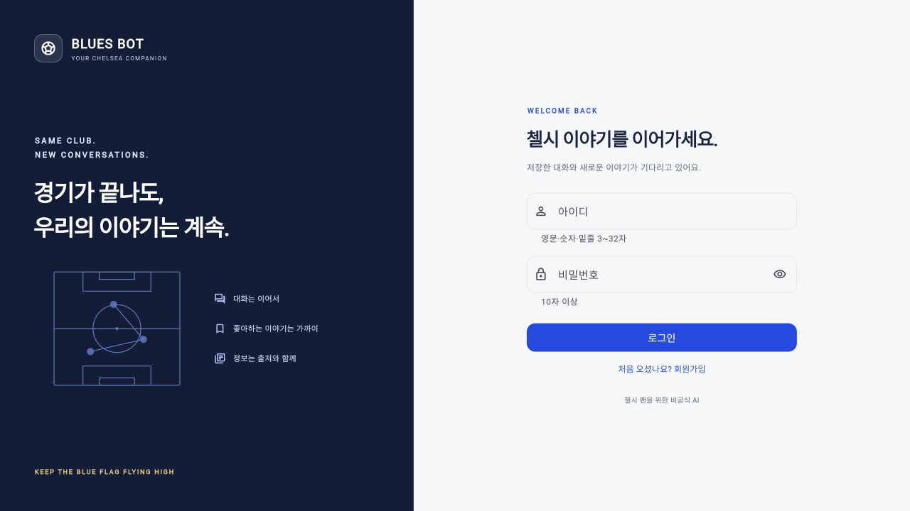
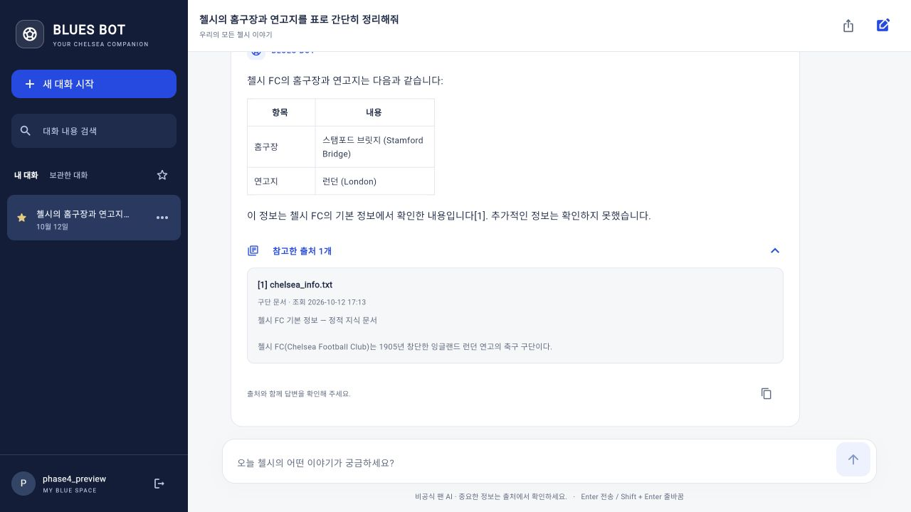
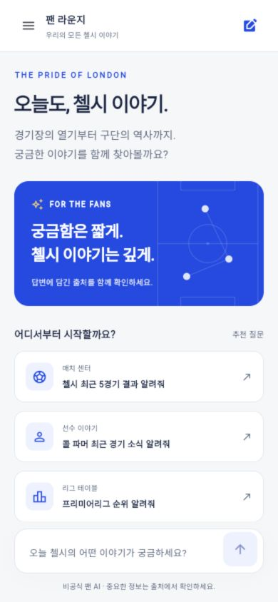

# 첼시 FC 전용 챗봇 Blues Bot 개발기 — Phase 5: 팬 라운지 리디자인과 대화 검색·즐겨찾기

> Phase 4에서 계정과 대화 복원을 구현했다. Phase 5에서는 다시 방문해 쓰기 편한 화면을 만드는 데 집중했다. 로그인부터 대화 탐색, 긴 답변을 읽는 흐름까지 함께 손봤다.

## 1. 기능이 늘어난 다음에 보인 문제

Phase 3에서는 문서 검색과 실시간 도구를 연결하고, 답변을 스트리밍으로 보여줬다. Phase 4에서는 사용자별 계정과 대화를 저장했다.

그런데 저장된 대화가 늘어나자 다른 문제가 드러났다. PC에서도 목록을 보려면 메뉴를 열어야 했다. 예전 답변을 찾으려면 제목을 하나씩 눌러야 했고, 표나 목록이 포함된 답변도 일반 텍스트로 표시됐다. 답변을 읽으려고 위로 올려도 새 토큰이 올 때마다 화면이 아래로 이동했다.

이번 목표는 세 가지로 잡았다.

1. 첼시 팬 서비스라는 인상을 주면서, 질문과 답변에 집중할 수 있는 화면을 만든다.
2. 저장한 이야기를 검색하고 즐겨찾기로 다시 찾는다.
3. 긴 답변과 출처를 읽는 흐름을 개선한다.

## 2. 팬 라운지로 바꾼 화면


### 색상과 간격을 한곳에서 관리하기

화면마다 색상을 직접 지정하던 방식에서 벗어나 `blues_theme.dart`에 공통 색상과 입력창·버튼·알림 스타일을 모았다.

| 역할 | 색상 | 적용 위치 |
| --- | --- | --- |
| 로열 블루 | `#184AE8` | 전송, 새 대화, 환영 배너 |
| 네이비 | `#101D3A` | 대화 탐색 영역, 로그인 소개 |
| 본문 | `#172544` | 제목, 답변 |
| 보조 문구 | `#5D6B82` | 안내, 자료 조회 시각 |
| 배경 | `#F6F7F9` | 채팅 공간 |
| 연한 블루 | `#EDF2FF` | 출처·상태 강조 |

전체를 파란색으로 채우기보다 탐색 영역은 어둡게, 읽는 영역은 밝게 구성했다. 사용자가 보낸 질문은 파란 말풍선, 답변은 흰 카드로 구분했다.

환영 화면에는 경기·선수·리그·구단 역사라는 네 가지 시작점을 배치했다. 카드는 실제 질문을 보내는 버튼이다. 실시간 데이터가 확인된 것처럼 가상의 경기 결과나 순위를 화면에 넣지는 않았다.

축구장 일러스트는 Flutter의 `CustomPainter`로 그린 장식이다. 실제 경기 배치도나 공식 구단 엠블럼을 뜻하지 않는다.

### 화면 크기에 맞춘 탐색

채팅 화면은 가로 1,000px 이상이면 왼쪽 대화 목록을 계속 보여준다. 그보다 작은 화면은 메뉴로 목록을 열어 채팅 공간을 확보한다. 추천 질문도 공간이 충분하면 두 열, 작으면 한 열로 배치한다.

로그인은 960px을 기준으로 소개 영역과 입력 폼을 나눈다. 모바일에서는 소개 영역을 접고 입력 폼과 브랜드만 보여준다. 비밀번호 표시 전환도 추가했다.



## 3. 제목뿐 아니라 질문과 답변도 검색하기

검색은 서버에 저장된 대화 제목·질문·답변을 대상으로 한다. 현재 계정의 활성 대화 또는 보관함 안에서 검색하고, 즐겨찾기 필터도 함께 적용한다.

```http
GET /api/v1/conversations?q=파머&pinned_only=true&archived=false
```

핵심 조건은 소유권을 검색 조건보다 바깥에 두는 것이다.

```sql
WHERE owner = ? AND archived = ?
  AND (? = 0 OR pinned = 1)
  AND (
    ? = ''
    OR instr(lower(title), lower(?)) > 0
    OR EXISTS (
      SELECT 1 FROM turns
      WHERE turns.session = conversations.id
        AND (
          instr(lower(question), lower(?)) > 0
          OR instr(lower(answer), lower(?)) > 0
        )
    )
  )
```

실제 구현에서는 별칭과 정렬·한도 조건을 함께 사용한다. 검색어는 문자열 결합 없이 모두 매개변수로 전달한다. `%`와 `_`는 와일드카드가 아닌 입력한 문자 그대로 찾는다.

현재는 최대 80자의 연속 문자열 검색이다. 영문 대소문자는 구분하지 않지만 형태소 분석이나 의미 검색은 아니다. 계정당 100개 대화와 대화당 최근 100턴이라는 기존 저장 한도 안에서 동작한다. 데이터가 훨씬 커진다면 전문 검색 인덱스를 검토할 수 있다.

### 늦게 도착한 검색 결과를 버리기

사용자가 `파`를 입력하고 곧바로 `파머`까지 입력했을 때, 먼저 보낸 요청의 응답이 더 늦게 도착할 수 있다. 이때 단순히 응답이 온 순서대로 화면을 바꾸면 이전 검색 결과가 다시 표시된다.

입력 후 250ms 동안 기다렸다가 요청하고, 입력이 바뀔 때마다 목록 요청 번호를 증가시켰다. 응답을 받은 뒤 현재 번호와 일치하는 경우에만 결과를 반영한다. 기다리는 동안에도 이미 진행 중인 이전 요청은 무효화한다.

이 방식은 검색뿐 아니라 보관함·즐겨찾기 필터 전환에도 적용했다.

## 4. 계정에 저장하는 즐겨찾기

즐겨찾기는 브라우저 메모리가 아니라 대화 테이블에 저장한다.

```sql
ALTER TABLE conversations
ADD COLUMN pinned INTEGER NOT NULL DEFAULT 0;
```

서버를 시작할 때 컬럼이 없는 경우에만 추가한다. 기존 계정과 대화는 그대로 두고 기본값은 해제 상태다.

```http
POST /api/v1/conversations/{id}/pin
Content-Type: application/json

{"pinned": true}
```

목록은 즐겨찾기를 먼저 보여주고, 각 그룹에서는 마지막 답변 시각으로 정렬한다. 별을 눌렀다는 이유로 대화의 `updated` 값을 변경하지는 않는다.

새로고침 후 대화를 복원할 때는 목록 첫 항목을 그대로 선택하지 않도록 수정했다. 즐겨찾기 때문에 목록 순서가 달라질 수 있으므로, 활성 대화 중 실제 마지막 답변 시각이 가장 최근인 항목을 선택한다.

즐겨찾기 변경도 소유권을 검사하고 생성 중인 대화에는 409를 반환한다. 다른 사용자의 ID를 전달하면 기존 대화 API와 동일하게 404로 응답한다.

## 5. 답변과 출처를 읽기 편하게

### Markdown과 넓은 표

답변 표시에는 `flutter_markdown_plus`를 사용했다. 제목, 강조, 목록, 인용문, 코드, 표를 렌더링한다. 넓은 표는 가로 스크롤하도록 설정해 작은 화면에서 전체 레이아웃을 밀어내지 않게 했다.

원래 답변 문자열은 바꾸지 않는다. 표시할 때만 렌더링하므로 저장된 Phase 4 답변에도 적용된다. 답변 복사는 원래 Markdown을 제공한다.

생성된 Markdown 안의 이미지는 자동으로 불러오지 않는다. 이미지 설명만 표시해 임의의 외부 이미지 요청이나 로컬 파일 읽기가 일어나지 않도록 했다. 링크는 사용자가 눌렀을 때 HTTP(S) 주소만 연다.

### 출처 카드

출처를 펼치면 제목, 자료 종류, 조회 시각, 발행일, 발췌문과 원문 링크가 나온다. 외부 주소가 없는 로컬 문서는 링크 버튼을 표시하지 않는다. API-Football 자료의 주소는 인증이 필요한 API 주소일 수 있으므로, 링크를 열었다고 항상 공개 기사처럼 읽을 수 있는 것은 아니다.

답변 아래의 복사 버튼에는 완료 알림을 추가했다. 상단의 대화 복사는 질문·답변·경고·출처 목록을 함께 제공한다. 파일 다운로드나 공유 URL을 만드는 기능은 이번 범위에 포함하지 않았다.

### 보관한 대화도 읽고 이어가기

이전에는 보관함에서 복원만 할 수 있었다. 이제 보관한 대화도 먼저 열어 읽을 수 있다. 읽는 동안은 입력창 대신 복원 버튼을 보여주고, 복원한 뒤에만 질문을 보낼 수 있다. 서버의 보관 대화 생성 차단도 유지한다.

## 6. 한글 입력과 스트리밍 스크롤

데스크톱 키보드는 Enter로 보내고 Shift + Enter로 줄을 바꾼다. 한글 조합 중 Enter까지 전송으로 처리하면 사용자는 마지막 글자를 확정하려다가 질문을 보낼 수 있다. 그래서 편집 값의 `composing` 범위가 활성 상태인지 확인해 전송을 막았다. 모바일에서는 전송 버튼을 사용한다.

스크롤은 사용자가 아래쪽에 있을 때만 새 토큰을 따라가도록 바꿨다. 이전 내용을 읽으려고 위로 올라가면 자동 이동을 멈추고, 최신 답변으로 돌아오는 버튼을 보여준다. 새 질문을 보내거나 다른 대화를 열면 해당 답변의 아래쪽으로 이동한다.

## 7. 검증 범위

로컬 자동 검사에서는 백엔드 46개와 Flutter 28개, 총 74개 테스트를 실행했다. Flutter 정적 검사와 웹 릴리스 빌드도 확인했다.

추가한 테스트는 다음과 같다.

- 백엔드: 즐겨찾기 저장·정렬·재시작 복원, 마지막 답변 시각 보존, 제목·질문·답변 검색, 와일드카드·따옴표 처리, 소유권과 보관함 필터, Phase 4 마이그레이션, 생성 중 변경 차단, API 입력 검증.
- Flutter: 고정 사이드바와 모바일 메뉴, 즐겨찾기, 최신 대화 복원, 오래된 검색 응답 무시, 보관 대화 읽기·복원, 좁은 화면의 표, 이미지 로딩 차단, 안전한 링크, 한글 조합, 복사 내용, 스트리밍 중 스크롤, 비밀번호 표시 전환.

자동 검사에서 발견한 브랜드 문구 넘침과 출처 카드의 Material 구성 문제를 수정했다. 실제 브라우저에서 새로고침 후 표를 복원했을 때 짧은 한글 열 제목이 세로로 꺾이는 문제도 발견해 열의 최소 폭을 확보했다. 320px 표·환영 화면과 390px·글자 배율 1.5의 모바일 화면도 테스트에 포함했다. 모든 보조 기술이나 실제 모바일 기기를 검증한 것은 아니다.

실제 브라우저에서는 테스트 계정으로 로그인한 뒤 OpenAI와 문서 검색을 통해 홈구장·연고지 표 답변을 생성했다. 본문에만 있는 영문으로 대화를 검색하고, 즐겨찾기와 새로고침 후 복원도 확인했다. 아래 이미지는 그 대화의 실제 화면이다.





GitHub Actions는 기존 Python 3.10/3.12 테스트와 Flutter 정적 검사·테스트·웹 빌드를 이어서 실행한다. 공급자 API는 자동 검사에서 모의 응답을 사용한다. Tavily와 API-Football의 실제 키·요금제별 응답은 별도 검증이 필요하다.

## 8. 다음 단계

이번 단계는 화면 사용성과 저장된 대화 탐색에 집중했다. 푸시 알림, 공개 배포, 네이티브 앱의 영구 로그인, 공유 링크는 아직 구현하지 않았다. 이후에는 실제 사용자의 질문 흐름을 살펴 추천 질문을 조정하고, 검색 결과의 일치 부분 표시나 모바일 기기 검증을 확장할 수 있다.

## 참고

- [Phase 4 개발기](phase4-blog.md)
- [Flutter Markdown Plus 공식 패키지 문서](https://pub.dev/packages/flutter_markdown_plus)
- [url_launcher 공식 패키지 문서](https://pub.dev/packages/url_launcher)
- [실행 방법과 API 안내](../README.md)
